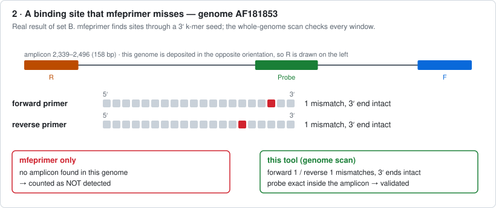
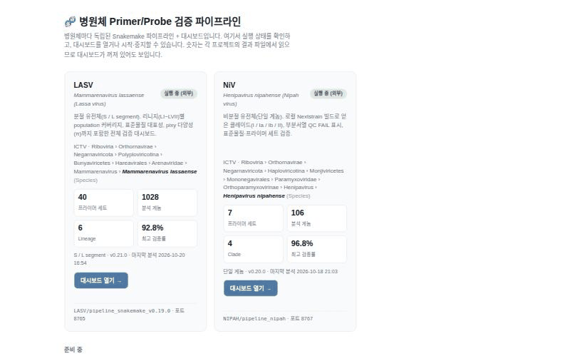
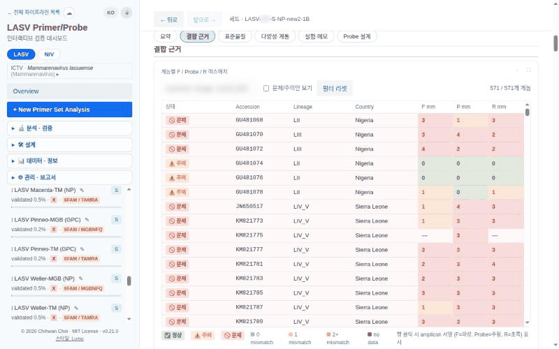
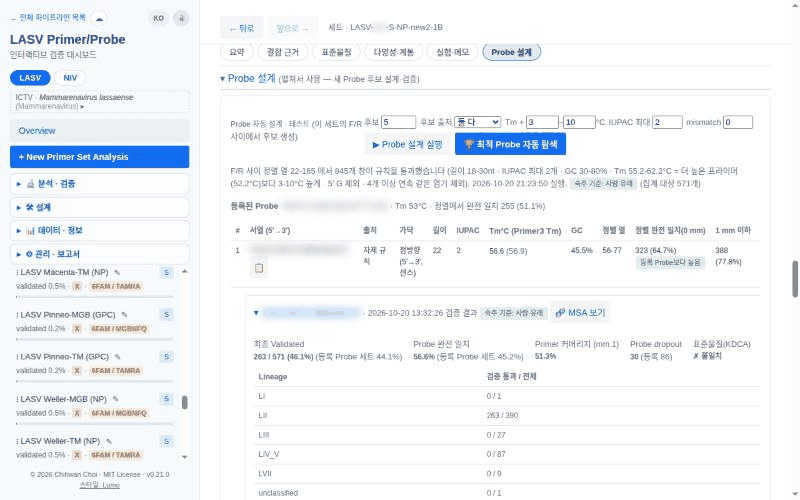
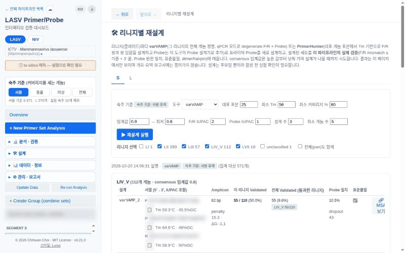

# TaqMan Primer/Probe Validator — LASV 에디션

  

[English README](README.md)  ·  Nipah 에디션: [`nipah`](https://github.com/CHOICHI-HWAN/TaqmanPrimerProbeValidator/tree/nipah) 브랜치

TaqMan 프라이머/프로브 세트가 **알려진 Lassa virus(LASV) 유전체를 얼마나 잡는지** 계산하고, 결과를 대화형 대시보드로 보여주는 도구입니다.
새 세트를 설계하거나 기존 키트를 점검할 때 *"이 세트가 알려진 유전체의 몇 %를 검출하나, 어떤 계통을 놓치나?"* 를 확인하는 용도입니다.

LASV 에디션은 두 분절(S, L)을 다루며, 유전체와 메타데이터는 Nextstrain의 공개 데이터셋입니다. Nipah 에디션은 `nipah` 브랜치에 있습니다.

자세한 문서(파이프라인 단계, 설정, 대시보드 기능, 디렉터리 구조): [docs/PIPELINE.md](docs/PIPELINE.md)

## 특징

1) **정확한 mismatch 계산.** mfeprimer가 보고하는 프라이머 문자열은 5′ 쪽 mismatch를 가리고 시드 단계에서 놓친 위치도 있습니다. 그래서 모든 위치를 **게놈 염기**로 다시 세고,
   mfeprimer와 독립적인 게놈 스캔을 둘 다 돌려 더 나은 결과를 씁니다. 프로브는 amplicon 안에 있을 때만 인정합니다.

   <details><summary><b>▶ 예시: 이 도구의 실제 결과</b></summary>

   네모 하나가 프라이머의 염기 하나입니다(5′ → 3′). **회색** = 게놈과 일치, **빨강** = 불일치. 서열은 그리지 않았습니다([이 저장소에 없는 것](#이-저장소에-없는-것) 참고). 파이프라인 결과에서 [`docs/make_examples.py`](docs/make_examples.py)가 만듭니다.

   **① mfeprimer 보고에 나타나지 않는 mismatch.** mfeprimer 보고 문자열은 프라이머 자신이라 3′ 시드 안의 mismatch만 보입니다. 게놈 염기로 다시 세면 5′ 쪽의 두 번째 mismatch가 드러나고, 이 게놈은 ≤ 1 기준을 통과하지 못합니다. (이 데이터에서 이 세트의 게놈 42개가 해당합니다.)

   

   **② mfeprimer가 놓치는 결합 위치.** mfeprimer는 이 게놈에서 amplicon을 아예 찾지 못해, 단독으로는 *검출 안 됨*으로 셉니다. 독립적인 게놈 전체 스캔은 프라이머 쌍(각 1 mismatch, 3′ 끝 일치)과 amplicon 안의 프로브 완전 일치를 찾습니다. (이 데이터에서 이 세트의 게놈 28개, 전체 세트로는 82개가 해당합니다.)

   

   </details>

2) **단순하고 명확한 판정 규칙.** *검증 통과* = F/R 프라이머 각각 mismatch ≤ 1(3′ 끝 일치) **그리고** 프로브 완전 일치. 결합은 되지만 기준을 조금 넘는 게놈은 따로(“주의”) 보여줍니다.

3) **숙주를 구분한 커버리지.** 기본은 **사람 유래 게놈** 기준이고, 클릭 한 번으로 동물·미상·전체로 바꿉니다. 실험 숙주 게놈은 어디에서도 제외합니다.

4) **리니지(LI~LVII)별 결과.** 리니지별 커버리지, 방향을 맞춘 amplicon 다중 정렬(F/Probe/R 위치, 참조 좌표, 뉴클레오타이드 다양성 π 막대).

5) **여러 세트 묶음(패널).** 합집합 커버리지와 **교차 결합**(세트 1의 forward + 세트 2의 reverse)을 확인합니다.

6) **표준물질 확인**(일부만 매치되는 경우 포함; 빨강 = 프로브 또는 프라이머 3′ 끝 mismatch, 노랑 = 감당되는 프라이머 mismatch), dimer·hairpin 점검, 유전자 보존영역, 엑셀 입출력.

7) **자체 점검.** `./test.sh`는 정답을 아는 합성 게놈을 실제 mfeprimer로 돌려 핵심 기능을 확인하고, `./test.sh --full`은 실제 결과까지 감사합니다.

8) **설계와 재설계.** 세트마다 Probe 설계 카드(자체 TaqMan 규칙 + Primer3, IUPAC 허용, 숙주 기준, 후보마다 실제 파이프라인 검증)와, 리니지별 **재설계** 페이지(varVAMP, PrimerHunter: 어떤 설계를 함께 쓰면 리니지를 덮는지 세트 커버로 표시).

9) **패널 겹침.** 세트·그룹을 골라 전체 또는 리니지별로 합집합·교집합·영역별 겹침·어느 것도 못 잡는 유전체를 **벤 다이어그램**으로 봅니다.

10) **쓰기 편한 화면.** 그룹 → 세트 트리(변이체는 부모에 접힘, 동일 서열 표시), 접히는 사이드바, 모든 페이지의 뒤로/앞으로, 세트 상세의 구역 이동 막대, 세트·그룹별 *채택/보류/탈락* 표시, LASV ⇄ NiV 전환, 바이러스별 ICTV 분류(Realm … Genus, Species) 표기.

## 개략도


## 대화형 대시보드


<details><summary>움직이는 화면 (숙주 기준 · 세트 상세 · 표준물질)</summary>


</details>

<details open><summary>0.21 새 기능 (이동 · 상세 창 · Probe 설계 · 재설계와 벤 다이어그램)</summary>

**그룹 → 세트 트리, ICTV 분류, LASV ⇄ NiV 전환, 뒤로/앞으로, 접히는 사이드바**



**상세 창: 복사, 이미지로 저장, 내용에 맞춤, 최소화, 최대화**



**Probe 설계 카드: 후보, 후보별 실제 검증, 그 Probe의 정렬**



**리니지별 재설계(varVAMP / PrimerHunter)와 커버리지 벤 다이어그램**



</details>

*(업체명, 프라이머·프로브·표준물질 서열과 표준물질 이름은 `docs/demo_blur.js`로 흐리게 처리했습니다.)*

## 설치

### 현재 버전

코드: **v0.24.0**   ·   Ubuntu 24.04, x86_64에서 테스트

### 필요한 것

| | |
|---|---|
| conda / mamba / micromamba | 환경(snakemake, mafft, pixy, htslib …)을 만듭니다 |
| **mfeprimer 4.2.4** | **저장소에 없고 conda로도 설치되지 않습니다. 직접 설치하세요(아래 3–4단계)** |
| 인터넷 | 유전체 내려받기, 선택 항목인 계통수 뷰어 |
| Chrome (선택) | PDF 보고서 내보내기만 |

**1)  코드 받기**

```bash
git clone https://github.com/CHOICHI-HWAN/TaqmanPrimerProbeValidator.git
cd TaqmanPrimerProbeValidator
```

**2)  환경 만들기** (4단계의 mfeprimer 경로를 물어봅니다. 다시 실행해도 안전합니다)

```bash
./setup.sh                       # = mamba env create -f environment.yml 후 경로를 config/config.yaml에 기록
conda activate primer_validation # snakemake를 직접 돌릴 때만 필요, ./start.sh는 필요 없음
```

**3)  mfeprimer 내려받기** — 단독 실행 파일(MFEprimer v4.2.4, linux-amd64). 공식 사이트 <https://www.mfeprimer.com/> 에서 받으세요.
공식 사이트가 재배포 조건을 밝히지 않아 이 저장소에는 넣지 않았으니 각자 따로 받으세요.

```bash
chmod +x /경로/mfeprimer-4.2.4-linux-amd64
/경로/mfeprimer-4.2.4-linux-amd64 version     # 버전이 나오면 정상
```

**4)  mfeprimer 경로 알려주기** (아래 중 하나):

- `./setup.sh`가 묻는 경로에 입력, 또는 `./setup.sh --mfeprimer /경로/mfeprimer-4.2.4-linux-amd64 --yes`
- `config/config.yaml`에 `mfeprimer_bin: "/경로/mfeprimer-4.2.4-linux-amd64"`
- 대시보드 **"분석 파라미터"** 페이지에서 입력 (저장할 때 한 번 실행해서 확인)
- 환경변수 `MFEPRIMER_BIN=/경로/mfeprimer-4.2.4-linux-amd64`
- 비워 두면 `../*/mfeprimer/` 또는 `PATH`에서 찾습니다

**5)  설치 점검** (약 10초, 모든 줄이 ✔ 이어야 합니다)

```bash
./test.sh
```

**6)  선택: 계통수 뷰어** ("Nextstrain 계통수" 카드용, MIT 라이선스라 번들하지 않았습니다)

```bash
curl -L -o webapp/static/vendor/peartree.bundle.min.js \
  https://github.com/artic-network/peartree/releases/latest/download/peartree.bundle.min.js
```

## Windows와 macOS

이 도구는 **Linux(Ubuntu 24.04)** 에서 만들고 테스트했습니다. 아래 Docker 방식도 Linux에서만 확인했고, 실제 Windows·macOS 컴퓨터에서는 **아직 실행해 보지 못했습니다.** 문제가 있으면 알려 주세요.

| 시스템 | 방법 |
|---|---|
| **Windows** (10/11) | **Docker Desktop**(권장, 아래) 또는 **WSL2**(Ubuntu 안에서 위의 Linux 설치 단계를 그대로). 순수 Windows는 지원하지 않습니다: mafft, htslib, pixy의 Windows 빌드가 없습니다. |
| **macOS** (Intel / Apple silicon) | **Docker Desktop**(아래), 또는 Miniforge로 직접 설치: `./setup.sh` + <https://www.mfeprimer.com/> 의 macOS용 mfeprimer (테스트 못 함, 환경 단계가 실패하면 Docker 사용). |
| **Linux** | 위의 설치 단계 또는 Docker. |

**Docker로 실행**(컨테이너가 Linux이므로 Windows·macOS에서도 mfeprimer는 위 3단계의 **linux-amd64** 파일을 받으세요. Apple silicon Mac은 에뮬레이션으로 돌아가 더 느립니다):

```bash
git clone https://github.com/CHOICHI-HWAN/TaqmanPrimerProbeValidator.git && cd TaqmanPrimerProbeValidator
export MFEPRIMER_BIN=/전체/경로/mfeprimer-4.2.4-linux-amd64        # PowerShell: $env:MFEPRIMER_BIN="C:\tools\mfeprimer-4.2.4-linux-amd64"
docker compose run --rm app ./test.sh                              # 설치 점검
docker compose up --build                                          # 대시보드: http://localhost:8765
```

`config/`, `data/`, `output/`은 프로젝트 폴더에 그대로 남고(컨테이너에 마운트), 포트는 이 컴퓨터에서만 열립니다. 사용자 id가 1000이 아닌 Linux에서는 먼저 `export UID GID=$(id -g)`를 실행하세요. 컨테이너에서 파이프라인은 `docker compose run --rm app snakemake --cores 4`로 돌립니다.

## 실행하기

*필수 입력:* **프라이머/프로브 세트** 하나 이상(그리고 선택적으로 **표준물질** 서열). 유전체는 자동으로 내려받습니다.

**대시보드 시작** — 화면은 기본이 한국어이고, 상단의 **EN** 버튼으로 영어로 바꿉니다.

```bash
./start.sh            # http://localhost:8765   (127.0.0.1에서만 열림 — 로그인이 없습니다)
```

**프라이머/프로브 세트 입력**: 대시보드 **"📝 프라이머 입력 / 관리"** 페이지(엑셀 다운로드·업로드 가능) 또는 `config/primers.tsv`(탭 구분):

| 열 | 의미 |
|---|---|
| `primer_name` | 표시 이름 (고유 ID `P001, P002 …`는 저장 시 자동 부여) |
| `segment` | `S` 또는 `L` |
| `forward_primer`, `reverse_primer`, `probe` | 5′→3′ 서열, IUPAC 축퇴 염기 가능 |
| `fluorophore`, `source`, `remark` | 형광체, 출처(업체·논문), 메모 |
| `proceed` | `True`면 분석에 포함 |

**유전체 내려받기 + 전체 분석**: 사이드바의 **"데이터 업데이트"**, **"분석 다시하기"** 버튼, 또는 터미널에서

```bash
snakemake --cores 4
```

**세트 하나만 다시 분석**

```bash
snakemake --cores 4 output/primers/P001/final/validated_ids.txt
```

**새 세트 하나를 빠르게 분석**(파이프라인 실행 없이): 사이드바 **"+ 새 프라이머 세트 분석"**.

**숙주 기준 선택**: 사이드바 "숙주 기준"(사람 · 동물 · 미상 · 전체). 스크립트에서도 같은 선택을 쓸 수 있습니다.

```bash
curl 'http://localhost:8765/api/sets?host=animal'
```

**문헌 프라이머** — 사이드바 **📚 문헌 프라이머**: 이 바이러스의 논문 속 TaqMan 프라이머·프로브 세트와 출처를 정리하는 목록입니다. 처음에는 비어 있고 이 컴퓨터에만 저장됩니다(`config/literature/<virus>.tsv`, git 제외). 모든 항목에 출처가 필요하고, ‘원문 대조 완료’는 확인한 위치(예: 표 번호)를 적어야만 표시할 수 있으며 나머지는 *미검증*으로 보입니다. 버튼 한 번으로 분석 목록에 추가합니다.

**신뢰하는 네트워크의 다른 컴퓨터에서 대시보드 열기**

```bash
python3 webapp/server.py --host 0.0.0.0 --port 8765
```

## 결과 파일

| 파일 | 내용 |
|---|---|
| `output/summary/summary.tsv` | 세트별 커버리지와 검증 통과율 (기본 숙주 기준, `host_scope` 열) |
| `output/summary/summary_by_lineage.tsv` | 리니지(LI~LVII)별 검증 통과 게놈 수 |
| `output/summary/group_summary.tsv` | 패널별 합집합 커버리지 |
| `output/primers/<ID>/alignment/mismatch_table.tsv` | 게놈별 F / 프로브 / R mismatch, 3′ 끝 상태, 위치 |
| `output/primers/<ID>/final/validated_ids.txt` | 통과한 accession |
| `output/primers/<ID>/msa/msa.json` | 대시보드에 보이는 amplicon 정렬 |

## 이 저장소에 없는 것

프라이머·프로브·표준물질·게놈(FASTA) **서열과 분석 결과는 버전 관리에서 제외합니다.** `config/`, `data/`, `output/`에 두고(git 제외),
서열이 섞이면 `tests/test_no_sequences_in_repo.py`가 실패하도록 자동 검사합니다. 테스트의 염기서열은 `tests/seqgen.py`가 만들어 씁니다. 공개 저장소의 업체명은 일반 이름(VendorA …)입니다.

## 서드파티 소프트웨어·데이터와 한계

**라이선스.** 이 프로젝트의 GPL-3.0-or-later 라이선스는 이 프로젝트를 위해 작성한 코드에만 적용되며, 아래 소프트웨어와 데이터에는 적용되지 않습니다. 자세한 내용: [THIRD_PARTY_LICENSES.md](THIRD_PARTY_LICENSES.md).

- **MFEprimer**는 독립적인 서드파티 소프트웨어이며 포함하지 않았습니다. 공식 사이트가 재배포 조건을 밝히지 않으므로 각자 <https://www.mfeprimer.com/> 에서 받아 개발자의 조건에 따라 사용하세요.
- **유전체 데이터**는 실행할 때 내려받으며 이 저장소에 저장하지 않습니다. LASV 유전체와 메타데이터는 Nextstrain(data.nextstrain.org, GenBank 유래)에서 받습니다. Nextstrain은 일부 기록을 발표 전 제공자의 허락하에 포함했다고 밝히므로, 공개되어 있다는 것이 제한 없는 재사용·재배포를 뜻하지는 않습니다. 결과를 발표할 때는 원 서열 제출자(`authors` 열)를 밝히고 Nextstrain을 인용하며, 내려받은 서열·메타데이터를 재배포하기 전에는 조건을 확인하세요.

**한계 — in silico 검증입니다.** 결과는 알려진 유전체 서열과 정해진 규칙(프라이머 각각 mismatch ≤ 1 + 3′ 끝 일치, 프로브는 amplicon 안에서 완전 일치)에 따른 컴퓨터 예측입니다. **실제 반응에서 세트가 결합·증폭·검출되는지는 이 결과만으로 객관적으로 판별할 수 없습니다.** 반응 조건, 중합효소와 시약, 2차 구조, 주형의 품질과 양, 그리고 데이터베이스에 없는 유전체나 서열 오류에도 좌우되기 때문입니다. 커버리지는 우연히 확보된 유전체(서열이 많이 해독된 시료·지역으로 치우침)에 대한 값이며 임상 민감도·특이도의 추정치가 아닙니다. 진단 목적으로 쓰기 전에 모든 세트를 반드시 실험으로 확인하세요. 연구용입니다.

## 인용

아직 이 도구의 논문은 없습니다. 아래처럼 이 소프트웨어를 인용하고, **바탕이 된 도구도 함께** 인용해 주세요.

**이 소프트웨어** — GitHub 저장소 오른쪽의 **“Cite this repository”**([CITATION.cff](CITATION.cff) 기반)에서 APA와 BibTeX를 바로 복사할 수 있습니다. 직접 쓰려면:

```bibtex
@software{choi_taqman_primer_probe_validator_2026,
  author  = {Choi, Chihwan},
  title   = {TaqMan Primer/Probe Validator},
  year    = {2026},
  version = {0.24.0},
  url     = {https://github.com/CHOICHI-HWAN/TaqmanPrimerProbeValidator}
}
```

**바탕이 된 도구:** **MFEprimer-3.0** (Wang K, et al. *Nucleic Acids Res.* 2019, doi:10.1093/nar/gkz351), MAFFT (Katoh & Standley 2013), pixy (Korunes & Samuk 2021), Snakemake (Mölder et al. 2021), Nextstrain (Hadfield et al. 2018).

서드파티 라이선스: [THIRD_PARTY_LICENSES.md](THIRD_PARTY_LICENSES.md) · [CHANGELOG.md](CHANGELOG.md) · [GPL-3.0-or-later](LICENSE)
