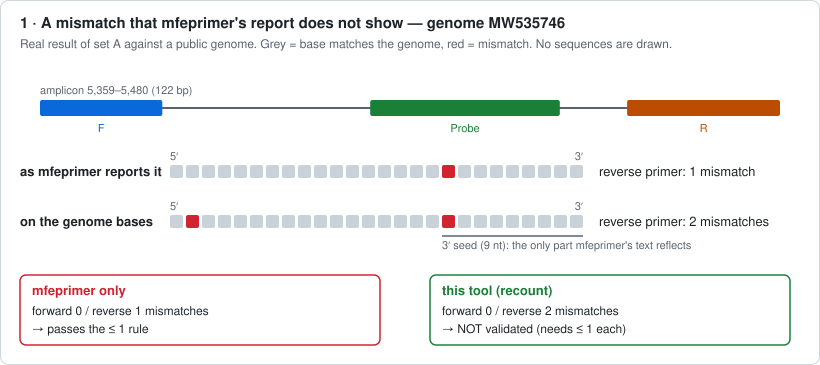
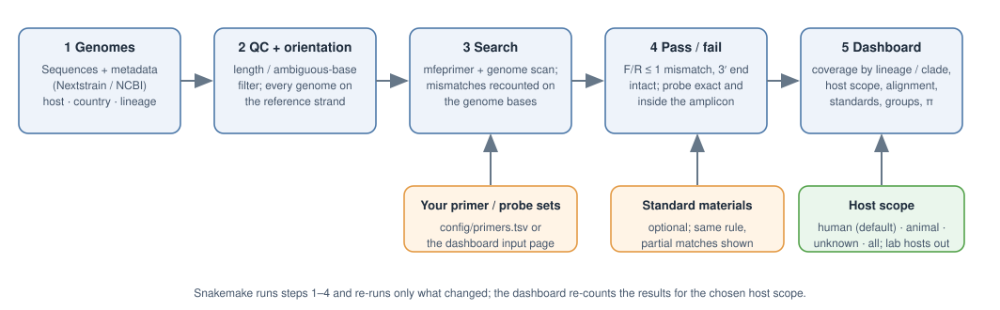
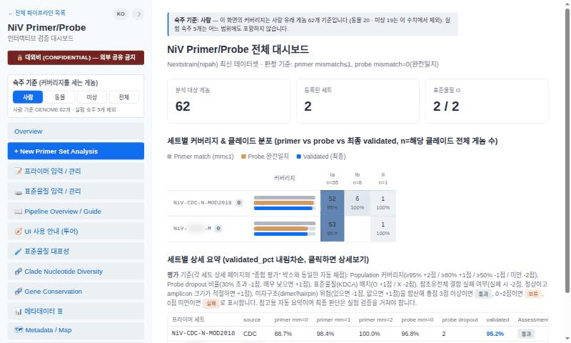
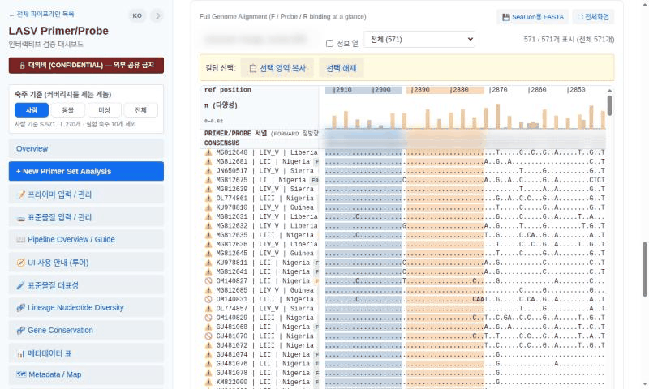
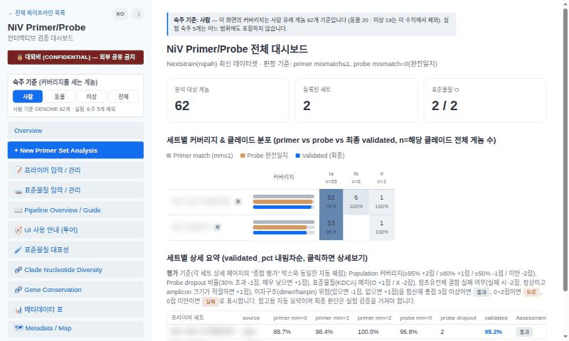
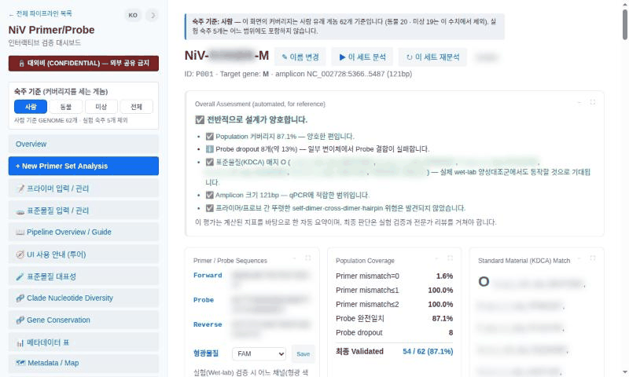
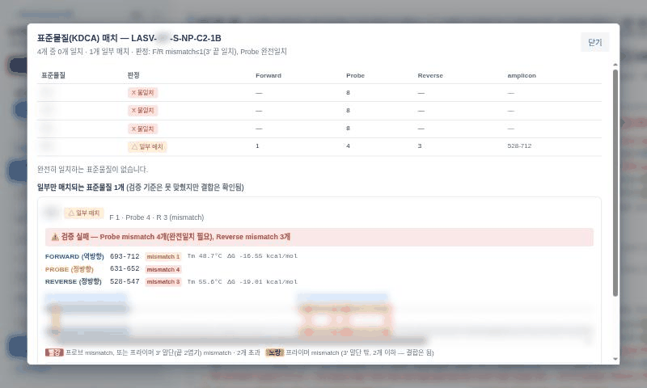

# TaqMan Primer/Probe Validator — Nipah edition

  

[한국어 README](README.ko.md)  ·  LASV edition: branch [`main`](https://github.com/CHOICHI-HWAN/TaqmanPrimerProbeValidator/tree/main)

This tool measures **how well a TaqMan primer/probe set detects the known genomes of a virus** (Nipah virus, NiV), and presents the result in an interactive dashboard.
Use it when you design a new set or check an existing kit: *"what fraction of the known genomes does this set detect, and which lineages does it miss?"*

The Nipah edition handles the unsegmented genome; clades come from the official nextstrain/nipah workflow built locally (partial sequences are flagged QC FAIL). The LASV edition is on the `main` branch.

Detailed documentation (pipeline steps, settings, dashboard features, directory layout): [docs/PIPELINE.md](docs/PIPELINE.md)

## Features

1) **Exact mismatch counting.** mfeprimer's reported primer text hides mismatches toward the 5′ end and sites its seed step misses. Every site is therefore recounted on the **genome bases**, and mfeprimer and an independent genome scan are both run (the better result is kept). A probe only counts when it lies inside the amplicon.

   <details><summary><b>▶ Example: real cases from this tool's results</b></summary>

   Each square is one base of a primer (5′ → 3′); **grey** = matches the genome, **red** = does not. No sequences are drawn (see [What is not in this repository](#what-is-not-in-this-repository)). Generated from the pipeline's own results by [`docs/make_examples.py`](docs/make_examples.py).

   **① A mismatch that mfeprimer's report does not show.** mfeprimer's report text is the primer itself, so only mismatches inside its 3′ seed appear in it. The recount on the genome bases finds the second mismatch toward the 5′ end, and the genome no longer passes the ≤ 1 rule. (In this edition's data, 1 genome of this set behaves like this.)

   

   **② A binding site that mfeprimer misses.** mfeprimer found no amplicon in this genome at all, so on its own it would count the genome as *not detected*. The independent whole-genome scan finds a primer pair (1 mismatch each, 3′ ends intact) with an exact probe inside the amplicon. (Shown from the LASV edition: no genome of the Nipah data needed this rescue.)

   

   </details>

2) **A simple, explicit pass/fail rule.** *Validated* = forward and reverse primer each ≤ 1 mismatch with an intact 3′ end **and** an exact probe match. Genomes that bind but only just miss the rule are shown separately (“caution”).

3) **Host-aware coverage.** Coverage is counted on **human-derived genomes by default**; switch to animal, unknown or all with one click. Laboratory-host genomes are excluded everywhere.

4) **Resolved by clade (I, Ia, Ib, II).** Coverage per clade, strand-normalised multiple alignment of the amplicon with F/Probe/R positions, reference coordinates and a nucleotide-diversity (π) track.

5) **Panels of several sets.** Group sets, see the union coverage, and detect **cross-binding** (set 1’s forward primer with set 2’s reverse primer).

6) **Standard-material check** including partial matches (red = probe or primer 3′-end mismatch, yellow = tolerated primer mismatch), self-/cross-dimer and hairpin screening, gene-conservation view, Excel import/export.

7) **Self-testing.** `./test.sh` runs synthetic genomes with a known answer through the real mfeprimer; `./test.sh --full` also audits the real results.

## Schematic



## Interactive dashboard





<details><summary>Animated tour (host scope · set detail · standard materials)</summary>







</details>

*(Vendor names, primer/probe/standard sequences, standard-material names and set names are blurred in these screenshots with `docs/demo_blur.js`.)*

## Installation

### Current version

Code: **v0.20.0 (Nipah edition)**   ·   Tested on Ubuntu 24.04, x86_64

### Requirements

| | |
|---|---|
| conda / mamba / micromamba | creates the environment (snakemake, mafft, pixy, htslib …) |
| **mfeprimer 4.2.4** | **not included and not on conda — install it yourself (steps 3–4 below)** |
| internet | genome download; the optional tree viewer |
| Chrome (optional) | only for the PDF report export |
| Nextstrain CLI (optional) | only for clade-level coverage: `./setup.sh --nextstrain`, then `scripts/run_nextstrain_nipah.sh` |

**1)  Get the code**

```bash
git clone https://github.com/CHOICHI-HWAN/TaqmanPrimerProbeValidator.git
cd TaqmanPrimerProbeValidator
git checkout nipah
```

**2)  Create the environment** (asks for the mfeprimer path in step 4; safe to re-run)

```bash
./setup.sh                       # = mamba env create -f environment.yml, then records the paths in config/config.yaml
conda activate primer_validation # only needed to run snakemake yourself; ./start.sh does not need it
```

**3)  Download mfeprimer** — a single static binary (MFEprimer v4.2.4, linux-amd64) from the official site <https://www.mfeprimer.com/>.
It is not redistributed here: the official site gives no redistribution terms, so each user downloads it separately.

```bash
chmod +x /path/to/mfeprimer-4.2.4-linux-amd64
/path/to/mfeprimer-4.2.4-linux-amd64 version     # prints the version if it works
```

**4)  Tell the pipeline where mfeprimer is** (any one of these):

- answer the prompt of `./setup.sh`, or run `./setup.sh --mfeprimer /path/to/mfeprimer-4.2.4-linux-amd64 --yes`
- set `mfeprimer_bin: "/path/to/mfeprimer-4.2.4-linux-amd64"` in `config/config.yaml`
- type it on the dashboard’s **Analysis Parameters** page (it is executed once to check it)
- export `MFEPRIMER_BIN=/path/to/mfeprimer-4.2.4-linux-amd64`
- leave it empty to auto-discover a binary under `../*/mfeprimer/` or on `PATH`

**5)  Check the installation** (about 10 seconds; every line should be ✔)

```bash
./test.sh
```

**6)  Optional: tree viewer** (used by the “Nextstrain tree” card; MIT-licensed, so it is not bundled)

```bash
curl -L -o webapp/static/vendor/peartree.bundle.min.js \
  https://github.com/artic-network/peartree/releases/latest/download/peartree.bundle.min.js
```

## Windows and macOS

The tool was developed and tested on **Linux (Ubuntu 24.04)**. The Docker setup below was tested on Linux only; it has **not** been run on real Windows or macOS machines yet — please report problems.

| system | how |
|---|---|
| **Windows** (10/11) | **Docker Desktop** (recommended, below) or **WSL2** (then follow the Linux steps inside Ubuntu). Native Windows is not supported: mafft, htslib and pixy have no Windows builds. |
| **macOS** (Intel / Apple silicon) | **Docker Desktop** (below), or natively with Miniforge: `./setup.sh` and mfeprimer’s macOS binary from <https://www.mfeprimer.com/> (untested; if the environment step fails, use Docker). |
| **Linux** | the Installation steps above, or Docker. |

**With Docker** (the container is Linux, so download the **linux-amd64** mfeprimer — step 3 above — even on Windows/macOS; Apple-silicon Macs run it through emulation, which is slower):

```bash
git clone https://github.com/CHOICHI-HWAN/TaqmanPrimerProbeValidator.git && cd TaqmanPrimerProbeValidator && git checkout nipah
export MFEPRIMER_BIN=/full/path/to/mfeprimer-4.2.4-linux-amd64        # PowerShell: $env:MFEPRIMER_BIN="C:\tools\mfeprimer-4.2.4-linux-amd64"
docker compose run --rm app ./test.sh                                 # check the installation
docker compose up --build                                             # dashboard at http://localhost:8767
```

Your `config/`, `data/` and `output/` stay in the project folder (it is mounted into the container); the port is published on this computer only. On Linux with a user id other than 1000 run `export UID GID=$(id -g)` first. Run the pipeline in the container with `docker compose run --rm app snakemake --cores 4`.

## Running the tool

*Required input:* one or more **primer/probe sets** (and, optionally, **standard-material** sequences). The genomes are downloaded for you.

**Start the dashboard** — the interface is in Korean by default; the **EN** button at the top switches it to English.

```bash
./start.sh            # http://localhost:8767   (127.0.0.1 only — there is no login)
```

**Enter your primer/probe sets** on the dashboard page **📝 Primer input / manage** (Excel download/upload supported), or edit `config/primers.tsv` (tab-separated):

| column | meaning |
|---|---|
| `primer_name` | display name (a permanent id `P001, P002 …` is assigned on save) |
| `segment` | `GENOME` (unsegmented genome) |
| `forward_primer`, `reverse_primer`, `probe` | 5′→3′ sequence, IUPAC degenerate bases allowed |
| `fluorophore`, `source`, `remark` | dye, origin (vendor / paper), free note |
| `proceed` | `True` = include in the analysis |

**Download the genomes and analyse everything** — use the buttons **Update Data** and **Re-run Analysis** in the sidebar, or on the command line:

```bash
snakemake --cores 4
```

**Re-run a single set**

```bash
snakemake --cores 4 output/primers/P001/final/validated_ids.txt
```

**Analyse one new set quickly** (no pipeline run): sidebar **+ New Primer Set Analysis**.

**Choose the host scope** — sidebar “Host scope” (human · animal · unknown · all). The same choice is available to scripts:

```bash
curl 'http://localhost:8767/api/sets?host=animal'
```

**Literature primers** — sidebar **📚 Literature primers**: a list of this virus's TaqMan primer/probe sets collected from papers, with the source of each. The list starts empty and is stored only on your computer (`config/literature/<virus>.tsv`, git-ignored). Every entry needs a source; “verified against the paper” can only be ticked together with the place where you checked it (e.g. a table), and everything else is shown as *unverified*. One click adds an entry to the analysis list. This edition ships a few openly licensed example sets from papers (credits in [examples/literature/SOURCES.md](examples/literature/SOURCES.md)) so the menu can be tried right away.

**Open the dashboard from another computer on a trusted network**

```bash
python3 webapp/server.py --host 0.0.0.0 --port 8767
```

## Output

| file | content |
|---|---|
| `output/summary/summary.tsv` | coverage and validated % per set (primary host scope, column `host_scope`) |
| `output/summary/summary_by_lineage.tsv` | validated genomes per clade (I, Ia, Ib, II) |
| `output/summary/group_summary.tsv` | union coverage of each panel |
| `output/primers/<ID>/alignment/mismatch_table.tsv` | per genome: F / probe / R mismatches, 3′-end status, positions |
| `output/primers/<ID>/final/validated_ids.txt` | accessions that pass |
| `output/primers/<ID>/msa/msa.json` | amplicon alignment shown in the dashboard |

## What is not in this repository

Primer, probe, standard-material and genome (FASTA) **sequences and analysis results are kept out of version control** — they live in `config/`, `data/` and `output/`, which are git-ignored,
and `tests/test_no_sequences_in_repo.py` checks automatically and fails if a sequence slips in. Tests generate their nucleotide strings (`tests/seqgen.py`). Vendor names in this public copy are neutral (VendorA …). The only sequences in this repository are the openly licensed, credited literature examples in `examples/literature/`.

## Third-party software, data and limitations

**Licence.** This project's MIT licence covers the code written for it. It does not apply to the software and data below. Details: [THIRD_PARTY_LICENSES.md](THIRD_PARTY_LICENSES.md).

- **MFEprimer** is independent third-party software and is not included. Its official site gives no redistribution terms, so each user downloads it from <https://www.mfeprimer.com/> and uses it under the developers' terms.
- **Genome data** are downloaded at run time and are not stored in this repository. Nipah genomes come from NCBI GenBank / RefSeq (INSDC); clades come from the `nextstrain/nipah` workflow, which is cloned at run time (that repository has no licence file, so none of its files are copied here). Public availability does not mean unrestricted reuse or redistribution: acknowledge the original sequence submitters and cite the data sources when you publish results, and check the terms before redistributing downloaded sequences or metadata.

**Limitations — in silico only.** The results are computational predictions from known genome sequences and the stated rules (each primer ≤ 1 mismatch with an intact 3′ end, probe an exact match inside the amplicon). They **cannot show whether a set really binds, amplifies or detects in a reaction**: that also depends on reaction conditions, polymerase and chemistry, secondary structure, template quality and amount, and on genomes that are missing from the database or contain sequencing errors. Coverage is relative to the genomes that happen to be available (biased towards what has been sequenced, and where), and is not an estimate of clinical sensitivity or specificity. Confirm every set experimentally before any diagnostic use. For research use only.

## Citation

There is no publication for this tool yet. Please cite the software as below, **and** the tools it builds on.

**This software** — on GitHub, **“Cite this repository”** (right sidebar, built from [CITATION.cff](CITATION.cff)) gives APA and BibTeX; or use:

```bibtex
@software{choi_taqman_primer_probe_validator_nipah_2026,
  author  = {Choi, Chihwan},
  title   = {TaqMan Primer/Probe Validator (Nipah edition)},
  year    = {2026},
  version = {0.20.0},
  url     = {https://github.com/CHOICHI-HWAN/TaqmanPrimerProbeValidator/tree/nipah}
}
```

**Tools it builds on:** **MFEprimer-3.0** (Wang K, et al. *Nucleic Acids Res.* 2019, doi:10.1093/nar/gkz351), MAFFT (Katoh & Standley 2013), pixy (Korunes & Samuk 2021), Snakemake (Mölder et al. 2021), Nextstrain (Hadfield et al. 2018).

Third-party licences: [THIRD_PARTY_LICENSES.md](THIRD_PARTY_LICENSES.md) · [CHANGELOG.md](CHANGELOG.md) · MIT licence, © 2026 Chihwan Choi.
