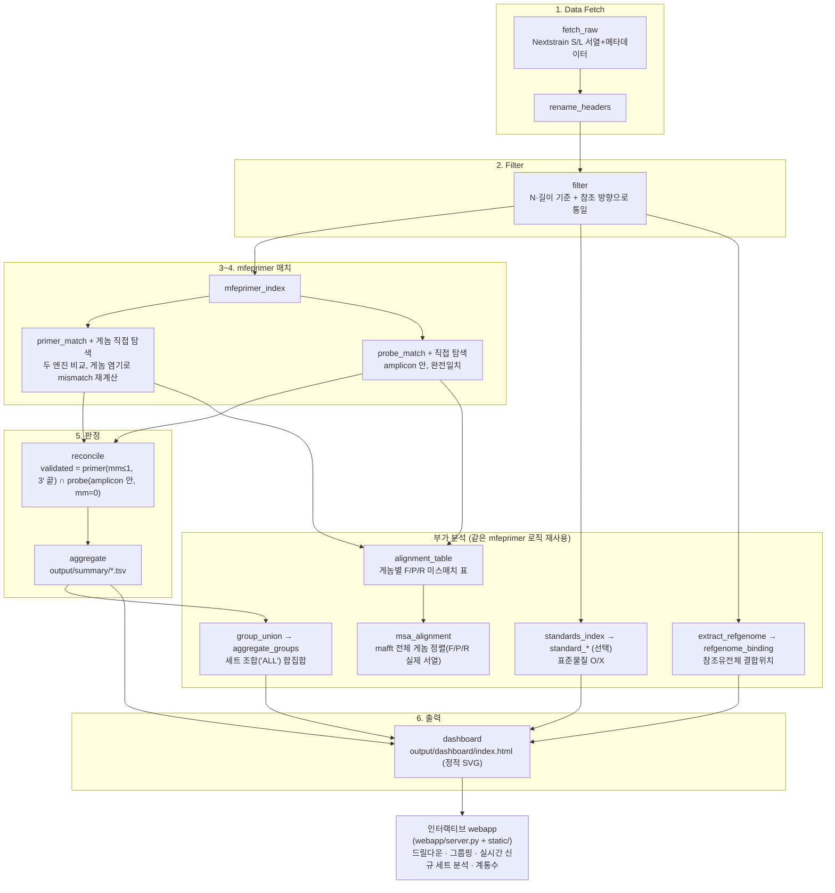
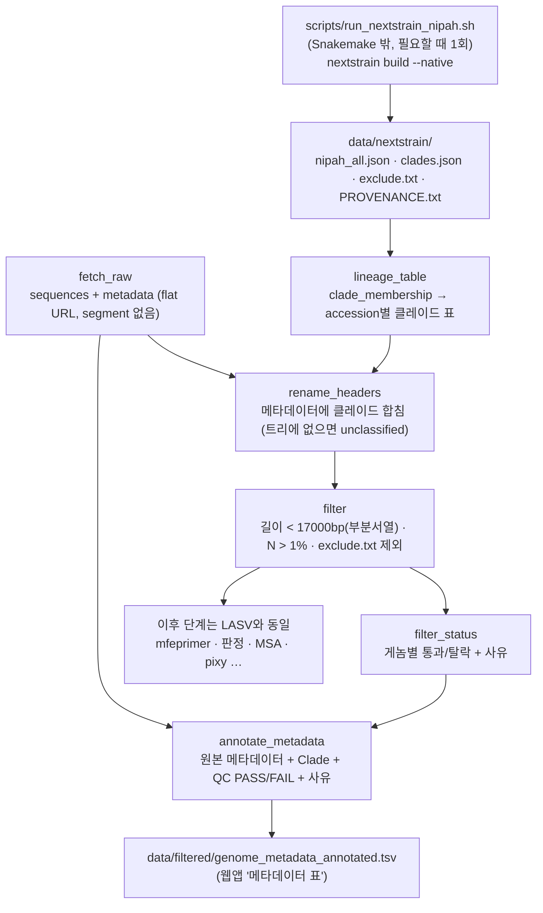

# Nipah Primer/Probe Validation Pipeline

TaqMan(프라이머 2개 + 프로브 1개) 검출 세트가 **알려진 바이러스 유전체 집단을 얼마나 잡는지**를 계산하고, 그 결과를 웹 대시보드로 살펴보는
Snakemake 파이프라인입니다. 비분절 유전체와 클레이드(I / Ia / Ib / II)별 커버리지를 다룹니다. 데이터는 로컬 Nextstrain 빌드로 얻습니다(부분서열은 QC FAIL로 표시).

- **정확한 mismatch 계산**: mfeprimer의 결과를 그대로 믿지 않고, 보고된 결합 위치의 **게놈 염기**를 직접 세어 5′ 쪽 mismatch와 시드 단계에서 놓친 위치를 보정합니다
  (mfeprimer와 자체 스캔을 둘 다 돌려 더 나은 쪽을 채택). 프로브는 amplicon 안에 있을 때만 인정합니다.
- **판정 규칙**: F/R mismatch ≤ 1(3′ 끝 일치), 프로브 완전 일치 → "검증 통과". 부분만 맞는 경우도 구분해서 보여줍니다(주의 / 허용 초과).
- **숙주 기준**: 커버리지는 **사람 유래 게놈**이 기본이고, 동물·미상·전체로 바꿔 볼 수 있습니다(실험 숙주는 제외).
- **대시보드**: 세트·그룹(여러 세트 묶음, 교차 결합 포함) 커버리지, 리니지/클레이드 분포, 전체 게놈 정렬(F/Probe/R 결합, 참조 좌표 눈금자, π 다양성 막대),
  표준물질 매치(부분 매치 포함), 유전자 보존영역, 엑셀 입출력, 새 프라이머 즉석 분석.
- **재현 가능**: `./test.sh`가 실제 mfeprimer로 정답을 아는 합성 게놈을 돌려 핵심 기능을 점검하고, `--full`은 실제 결과를 감사합니다.

## 화면 미리보기

업체명과 프라이머·프로브·표준물질의 서열과 이름은 `docs/demo_blur.js`로 **흐리게 처리**해서 녹화했습니다.

**숙주 기준 전환** (사람 → 동물 → 전체): 모든 수치와 표가 같은 기준으로 다시 계산됩니다.


**세트 상세**: 평가, 커버리지, 전체 게놈 정렬(참조 좌표 눈금자와 π 막대), 게놈별 결합 상세. 빨강은 프로브 또는 프라이머 3′ 끝 mismatch, 노랑은 결합에 지장 없는 프라이머 mismatch입니다.


**표준물질 매치**: 통과(O), 일부만 매치(△, 결합은 확인됨), 불일치(X)를 함께 보여줍니다.


> 직접 녹화할 때는 대시보드 페이지에서 `docs/demo_blur.js`를 실행한 뒤 화면을 캡처하고, `python3 docs/make_gif.py out.gif 프레임들…`로 GIF를 만드세요.

## 빠른 시작

```bash
./setup.sh      # conda/mamba 환경 + mfeprimer 경로 설정 (대화형)
./start.sh      # 웹 대시보드 (http://localhost:8765)
./test.sh       # 핵심 기능 점검 (약 10초). ./test.sh --full 은 실제 결과까지 감사
snakemake --cores 4   # 전체 파이프라인
```

대시보드는 기본적으로 **이 컴퓨터에서만**(`127.0.0.1`) 열립니다. 다른 PC에서 열어야 하면 `--host 0.0.0.0`을 직접 주세요(로그인이 없습니다).

## 이 저장소에 없는 것

프라이머·프로브·표준물질·게놈(FASTA) **서열과 분석 결과는 저장소에 두지 않습니다**(`.gitignore`, `tests/test_no_sequences_in_repo.py`가 서열이 들어 있으면 실패).
사용자가 `config/primers.tsv`(서열 포함)와 표준물질을 직접 채워 넣어 실행합니다. 테스트에 필요한 염기서열은 `tests/seqgen.py`가 만들어 씁니다.
공개 저장소에 올라간 코드의 업체명은 일반 이름(VendorA…)으로 바뀌어 있습니다.

## 단계 구성

| # | 단계 | 규칙(rule) | 설명 |
|---|---|---|---|
| 1 | data fetch | `fetch_raw`, (`lineage_table`), `rename_headers` | Nextstrain에서 sequences/metadata 다운로드 + 계통(lineage/clade) 라벨 부여 |
| 2 | filter | `filter`, `filter_status`, `annotate_metadata` | N·길이 기준 통과 서열만 남기고 QC PASS/FAIL 표시. 통과한 게놈은 **참조유전체와 같은 방향으로 통일**(`orientation.py`) |
| 3~4 | F/R · 프로브 탐색 | `mfeprimer_index`, `primer_match`, `probe_match`, `alignment_table` | mfeprimer + **게놈 전체 직접 탐색** 두 엔진으로 모든 게놈에서 탐색, mismatch는 **게놈 염기로 재계산**, 3′ 끝·amplicon 안 프로브 확인 |
| 5 | 최종 판정 | `reconcile`, `aggregate`, `engine_concordance` | validated = F/R(mismatch≤설정, 3′ 끝 일치) ∩ 프로브(amplicon 안, 완전일치). 두 엔진 일치율 요약 |
| 6 | 대시보드 | `dashboard` | `output/dashboard/index.html` (정적 SVG) + 인터랙티브 webapp |

추가 분석(같은 탐색 로직 재사용):

| 추가 요소 | 규칙(rule) | 설명 |
|---|---|---|
| 표준물질 매치 (**선택 사항**) | `standards_index`, `standard_primer_match`, `standard_probe_match`, `standard_alignment_table`, `standard_reconcile`, `standard_aggregate` | 등록한 표준물질(양성대조물질)이 있는 segment에서만 실행. 없으면 건너뛰고 빈 요약표만 만듭니다 |
| 세트 조합("ALL") | `group_union`, `group_cross_binding`, `group_standard_binding`, `group_refgenome_binding`, `aggregate_groups` | 그룹 커버리지를 **합집합(세트별 단독)** 과 **교차 결합 포함**(세트 간 올리고 조합) 두 값으로 계산 |
| 참조유전체 결합위치 | `extract_refgenome`, `refgenome_index`, `refgenome_binding` | 세트별 F/Probe/R이 참조유전체 어디에 결합하는지 |
| 정렬(MSA) · 이차구조 | `msa_alignment`, `dimer_hairpin_check` | mafft 정렬(기준은 프라이머/프로브 또는 consensus), dimer·hairpin |
| 유전체 다양성 · 보존영역 | `build_diversity_vcf`, `run_pixy` (+ webapp "유전자 보존영역") | 리니지별 π, 유전자마다 보존 정도 |
| 검증 | `./test.sh`, `scripts/audit_*.py` | 정답을 아는 합성 게놈 테스트와 실제 결과 감사(mismatch 재계산, 쌍 누락, 가닥 방향) |

### 전체 워크플로 다이어그램



### Nipah 프로필의 데이터 단계 (`profile: profiles/nipah.json`)

Nipah는 분절이 없는 단일 게놈이고, 원본 메타데이터에 클레이드가 없어서 데이터 단계가 위 LASV 흐름과 다릅니다.
클레이드는 **공식 nextstrain/nipah 워크플로를 로컬 Nextstrain CLI로 직접 빌드**한 Auspice 트리에서 가져옵니다(웹의 Auspice 파일은 쓰지 않음).



- QC FAIL 사유: `길이 미달 (부분 서열)`, `모호염기(N) 과다`, `제외 목록(exclude list)`. 탈락한 게놈도 메타데이터 표에 남고 `QC FAIL`로 표시됩니다.
- 새 데이터로 갱신할 때는 `scripts/run_nextstrain_nipah.sh`를 다시 돌린 뒤 파이프라인을 실행하면 클레이드와 제외목록이 함께 바뀝니다.

`config/config.yaml`의 `primer_mismatch_pass`(기본 1)/`probe_mismatch`(기본 0)가 5번 판정 기준을 결정하고, 대시보드의 "⚙ 분석 파라미터 설정" 페이지에서 값을 바꾼 뒤 "분석 다시하기"를 누르면 mfeprimer 재검색 없이 `reconcile`부터만 다시 돌아 결과에 반영됩니다.

## 공개 문헌 기반 preset

`config/primers.tsv`의 `source` 컬럼이 `PUBLISHED`인 세트는 논문에 공개된(재배포 제약 없는) 서열입니다.
현재 `PUB_OLSCHLAGER_2010` 1개가 있으며, 정확한 출처와 인용 정보는 로컬 파일 `PUBLISHED_PRIMERS.md`에 있습니다(GitHub에는 서열을 올리지 않으므로 저장소에는 없습니다)
참고하세요.(서열을 짐작해서 옮기지 않기 위해, 원문을 직접 대조할 수 있는 경우에만 추가했습니다).

## 설치 (처음 한 번)

```bash
./setup.sh            # conda/mamba 환경 생성 + mfeprimer 경로 입력 (대화형)
./start.sh            # 웹앱 실행
```

`setup.sh`가 하는 일: ① mamba / micromamba / conda 중 하나를 찾아 `environment.yml`로 환경(기본 이름 `primer_validation`)을 만들고
(이미 있으면 그대로 사용, `--update`로 갱신), ② snakemake · mafft · pixy · bgzip · tabix · zstd 동작을 확인하고, ③ **mfeprimer 실행 파일
경로**를 묻고(실제로 `version`을 실행해 확인), ④ 환경 경로와 mfeprimer 경로를 `config/config.yaml`(`env_prefix`, `mfeprimer_bin`)에 기록합니다.
`start.sh`와 웹앱이 이 값을 읽으므로 `conda activate`를 따로 하지 않아도 됩니다. mfeprimer는 conda로 설치되지 않는 단독 실행 파일이라
직접 받아 두어야 하며, 경로는 웹앱의 **"Analysis Parameters"** 페이지에서도 언제든 바꿀 수 있습니다(저장할 때 실제로 실행해 보고 맞을 때만 반영).

```bash
./setup.sh --env my_env --mfeprimer /path/to/mfeprimer-4.2.4-linux-amd64 --yes   # 비대화형
```

여러 프로젝트(LASV, Nipah)는 같은 환경을 공유해도 되고(`--env`로 같은 이름 지정), 각자 만들어도 됩니다. 서로 다른 폴더에서 동시에 분석을 돌려도
작업 파일·잠금(`.snakemake/`)·mfeprimer 인덱스가 모두 프로젝트 폴더 안에 있어 충돌하지 않습니다(CPU만 나눠 씁니다 — 둘을 함께 돌린다면
`mfeprimer_cpu`를 코어 수의 절반 정도로 낮추세요).

## 실행

```bash
# 위 설치 단계에서 만든 환경을 켠 뒤 (start.sh로 웹앱만 쓸 때는 필요 없음)
conda activate primer_validation
snakemake --cores 16          # 전체 파이프라인 (rule all: dashboard + summary 테이블)
snakemake --cores 16 -n       # dry-run으로 실행 계획만 확인
snakemake --cores 4 output/primers/P001/final/validated_ids.txt   # 특정 프라이머(ID)만 재실행
snakemake --dag | dot -Tpng > dag.png   # DAG 시각화 (graphviz 필요)
```

primer/probe 세트는 웹앱의 **"📝 프라이머 입력 / 관리"** 스프레드시트 페이지(또는 `config/primers.tsv` 직접 편집)로
추가/변경합니다. 파일 형식(탭 구분): `primer_id(자동), primer_name, segment(S/L), forward_primer, reverse_primer,
probe, fluorophore, source, remark(제조사 제품명 등 자유 메모), proceed(True/False), add_date(저장 시 자동)`.

- **영구 ID**: 각 프라이머는 저장 시 `P001, P002…`가 부여되고(`config/id_registry.json`에 기록, 삭제된 ID도 재사용 안 함),
  파이프라인 내부·결과 폴더·메모/실험검증 기록은 모두 이 ID를 키로 씁니다. 이름은 표시용이라 언제든 바꿔도 됩니다.
  그룹도 `G001…` ID를 가지며 멤버는 프라이머 ID로 저장됩니다(`config/set_groups.tsv`).
- **`input_primers/`**: 분석 시작 시 매니페스트를 `input_primers/<ID>.tsv`(서열만)와 `input_primers/groups.tsv`로 복사해
  파이프라인이 이 스냅샷만 읽습니다. 내용이 바뀐 프라이머의 파일만 갱신되므로 그 프라이머만 다시 계산됩니다
  (이름·출처·형광물질만 바꾼 경우는 재계산 없음).
- `proceed=False`인 행은 파이프라인에서 완전히 제외됩니다.
- mismatch 기준이나 길이 필터는 `config/config.yaml`에서 바꿀 수 있습니다. 둘 다 바뀌면 Snakemake가 영향받는 다운스트림
  job만 자동으로 다시 계산합니다(예: primer 하나만 추가해도 fetch/filter/index는 재사용됨).

### 게놈 방향 통일

필터링 단계에서 통과한 모든 게놈을 **참조유전체와 같은 방향**으로 맞춥니다(참조와 공유하는 11-mer가 역상보 쪽에서 더 많으면 뒤집음, `scripts/orientation.py`). 뒤집은 게놈은 `data/filtered/<seg>_orientation.tsv`와 필터 리포트에 기록됩니다. 덕분에 좌표·증폭 산물 서열·정렬이 모든 게놈에서 같은 방향입니다(LASV S 662개 중 619개, L 366개 중 43개가 반대 방향이었음).

### 판정 방식과 mfeprimer의 관계 (검증 결과)

mfeprimer는 **후보 결합 위치를 찾는 데** 쓰고, 판정에 쓰는 mismatch 개수는 그 위치의 **실제 게놈 염기**와 프라이머를 비교해 다시 셉니다.
mfeprimer의 `--misMatch`는 3′ 끝 k-mer(기본 9염기) 안의 mismatch만 반영하고 보고 서열도 프라이머 자신이라, 5′ 쪽 mismatch가 0으로 나오기 때문입니다.

- **검증**: `python3 scripts/audit_recount.py`가 모든 위치·양쪽 가닥을 무차별 대입으로 다시 세어 `mismatch_table.tsv`와 비교합니다(LASV 25개, Nipah 2개 세트 전부 일치).
- **mfeprimer 원 결과와의 비교 (2026-10-15)**: mfeprimer만 통과시키는 게놈은 5′ 쪽 mismatch ≥2인 경우(LASV P003 98개, P011 208개), 우리만 통과시키는 게놈은 mfeprimer가 `--misMatch 1`에서 놓친 사이트(LASV P001 90개), `--misMatch 2`는 거의 전부 통과시켜 기준으로 부적합(LASV P016~P019: 우리 0건 vs mfeprimer 100%), 프로브 단독은 거의 일치(차이는 증폭 산물 밖 프로브 제외).
- **두 엔진 비교**: 모든 게놈에 mfeprimer와 게놈 전체 직접 탐색(`scan_fr`)을 함께 돌려 더 나은 쌍을 씁니다. 게놈별 비교는 `output/primers/<ID>/alignment/engine_comparison.tsv`, 세트별 일치율은 `output/summary/engine_concordance.tsv`. mfeprimer가 놓친 쌍은 LASV P004 29개, P020 22개 게놈 등이며, 직접 탐색이 mfeprimer보다 나쁜 경우는 없음.
- 프로브는 두 프라이머 사이에 있어야 통과. Tm/ΔG/dimer/hairpin은 mfeprimer 계산값 그대로(판정에는 미사용).

### 표준물질 정의

표준물질(양성대조물질)은 웹앱의 **"🧫 표준물질 입력 / 관리"** 스프레드시트(`config/standards.tsv`: name, segment, sequence,
source, remark, proceed, add_date)에서 관리합니다. 저장하면 파이프라인이 읽는 `config/kdca_standard_<seg>.fasta`와
`_metadata.tsv`가 자동으로 만들어집니다. 이름은 결과와 실험 검증 기록의 ID로 쓰이므로 저장된 이름을 바꾸거나 지우면 기존
기록과 연결이 끊어집니다.

### 표준물질 대표성

`output/standards/{s,l}/representativeness.json`(규칙 `standard_representativeness`)은 KDCA 표준물질이
품질 필터를 통과한 전체 게놈을 얼마나 대표하는지를 계산합니다 — 표준물질 구간 일치율, 세트별 결합 부위
일치율, 그 위치의 pixy π(보존/고변이). 합집합 일치율 90% 이상 적합, 50% 이상 재검토 권고, 미만 심각이며
기준은 `config/config.yaml`의 `standard_rep_*`에서 바꿉니다. 웹앱 사이드바의 "🧪 표준물질 대표성"에서 확인합니다.

## 숙주 기준 (사람 / 동물 / 미상 / 전체)

진단용 프라이머는 사람 검체를 잡아야 하므로, 커버리지는 **사람 유래 게놈 기준**이 기본입니다. 대시보드 왼쪽 위의 **"숙주 기준"** 에서
사람 · 동물 · 미상 · 전체로 바꿔 볼 수 있습니다(개요, 세트·그룹 상세, 정렬, 리니지 분포가 모두 같은 기준으로 다시 계산됩니다).

- **분류** (`scripts/host_scope.py`): 원본 메타데이터의 `host`로 사람(`Homo sapiens`, `human`, `patient` 등) / 동물 / 미상(비어 있거나 `unknown` 등)을
  나눕니다. `non-human primate` 같은 표기는 동물입니다. 세부 분류(설치류·박쥐 등)는 하지 않습니다.
- **실험 숙주 제외**: 메타데이터의 `is_lab_host`가 참인 게놈(세포주·실험실 계대 등)은 **어느 범위에도 포함하지 않습니다**.
- **기본 범위**: 사람 게놈이 하나라도 있으면 사람, 하나도 없으면(숙주 정보가 없는 바이러스) 전체. 숙주 정보가 없는 게놈은 사람으로 가정하지 않고 "미상"입니다.
- **파이프라인**: `output/summary/summary.tsv`, `group_summary.tsv`의 수치는 기본 범위(`host_scope` 열) 기준입니다. 판정 규칙(프라이머·프로브 통과)은
  `host_scope.py`에 한 곳에만 있고, 파이프라인(`reconcile.py`)과 웹 앱이 같은 코드로 셉니다. 통과 id 목록(`validated_ids.txt` 등)은 모든 게놈 기준 그대로입니다.
- **웹 API**: 읽기 요청에 `?host=human|animal|unknown|all`을 붙입니다(없으면 기본 범위). 응답의 `host_scope`에 범위별 게놈 수가 들어 있습니다.
- **프로필**: `profiles/*.json`의 `metadata`에 `host`, `lab_host`(원본 열 이름)를 줄 수 있습니다. 생략하면 `host`, `is_lab_host`.
- 다양성(π)과 표준물질 대표성은 숙주와 무관하게 전체 집단으로 계산합니다.

## 핵심 기능 점검 (`test.sh`)

```bash
./test.sh          # 핵심 점검(약 10초): 도구 확인 + 정답을 아는 합성 게놈으로 mfeprimer·재계산·게놈 직접 탐색·프로브·방향 통일까지 실제로 돌림
./test.sh --full   # + 전체 테스트, snakemake -n, 실제 결과 감사(audit_recount / audit_pairs / audit_strands), 두 엔진 일치 확인
```

종료 코드는 모든 점검이 통과했을 때만 0입니다. 새 컴퓨터에서는 먼저 `./setup.sh`를 실행하세요.
합성 게놈 테스트(`tests/test_core_e2e.py`)는 5′ 쪽 mismatch, 3′ 끝 mismatch, 프로브 mismatch, 증폭 산물 밖의 프로브, 반대 방향 게놈, 무관한 서열을 정답과 비교합니다.

## 테스트

`tests/`에 핵심 파싱/좌표 로직(3' 말단 방향 판정, whole-genome orientation 정규화,
mfeprimer dimer/hairpin 리포트 파서 등 — 실제로 한 번씩 버그가 났던 부분들)에 대한 pytest
회귀 테스트가 있습니다. population 데이터나 mfeprimer 실행 없이 순수 함수만 검증하므로 빠르게
돕니다.

```bash
pip install pytest   # 최초 1회
cd pipeline_snakemake
pytest tests/ -v
```

## 디렉터리와 모듈 구조

워크플로는 **바이러스(종) 정의**와 **단계별 규칙 모듈**로 나뉘어 있습니다.

- **프로필** (`profiles/<id>.json`, `scripts/virus_profile.py`): 데이터 출처, segment(길이 하한·리니지 컬럼·참조 accession),
  메타데이터 컬럼 매핑, 풀링 집단 이름, diversity QC 기준처럼 *어떤 바이러스인지*에 해당하는 값을 한곳에 모았습니다.
  `config/config.yaml`은 `profile:`로 하나를 고르고 실행 설정(mismatch, CPU 등)만 갖습니다. 필드 설명은 `profiles/README.md`.
- **규칙 모듈** (`rules_*.smk`): `Snakefile`은 설정·프로필·매니페스트를 읽어 공통 변수를 만들고 `rule all`과 아래 모듈을 `include`합니다.
  모듈은 `Snakefile`과 같은 위치에 두었습니다 — Snakemake가 스크립트 경로를 정의한 파일 기준으로 해석하고, 경로 문구가 바뀌면
  기존 결과가 모두 "코드 변경"으로 보여 재계산되기 때문입니다.

| 모듈 | 단계 |
|---|---|
| `rules_data.smk` | fetch → 헤더 정리 → 길이/N 필터 → 필터 결과 기록 → mfeprimer 인덱스 |
| `rules_matching.smk` | primer 매치, probe 완전일치, reconcile(통과 판정), 집계 |
| `rules_standards.smk` | 표준물질 매치·상세, 표준물질 대표성 |
| `rules_groups.smk` | 그룹 합집합, 세트 간 교차 결합 |
| `rules_reference.smk` | 참조유전체 추출·인덱스·결합 위치, 유전자 요약 |
| `rules_qc.smk` | 이차구조(dimer/hairpin), 게놈별 mismatch 표, MSA |
| `rules_diversity.smk` | 정렬 기반 VCF, pixy 다양성 |
| `rules_report.smk` | 정적 대시보드 |

```
profiles/lassa.json, README.md             # 바이러스 프로필 (서열 없음 — 공유 가능)
config/
  config.yaml                              # 프로필 선택 + mismatch 기준, mfeprimer_bin 경로 등 실행 설정
  primers.tsv                              # 검증 대상 프라이머 세트 매니페스트 (스프레드시트 포맷)
  standards.tsv                            # 표준물질 매니페스트 → kdca_standard_{s,l}.fasta(_metadata.tsv) 자동 생성
  set_groups.tsv                           # "ALL" 합집합 조합 정의
scripts/
  virus_profile.py, standards_common.py, mfe_common.py   # 프로필 / 표준물질 정의 / mfeprimer 공용 함수
  fetch_one.sh, rename_headers.py, filter.py, filter_status.py   # 1~2단계
  build_index.py, run_primer.py, run_probe.py      # 3~4단계 (population + 표준물질 공용)
  reconcile.py, aggregate.py                       # 5단계 (population + 표준물질 공용)
  group_union.py, aggregate_groups.py              # "ALL" 합집합
  extract_refgenome.py, run_refgenome_binding.py   # 참조유전체 결합위치 조회
  genome_track.py                                  # 결합위치 SVG 트랙 렌더러
  dashboard.py, svg_charts.py                      # 6단계 (순수 python SVG 차트, matplotlib 불필요)
data/{raw,renamed,filtered,refgenome}/                        # 1~2단계 + 참조유전체 산출물
input_primers/<ID>.tsv, groups.tsv                          # 파이프라인 입력 스냅샷
output/primers/<ID>/{primer_qc,probe_qc,alignment,final,refgenome_binding,…}/   # 프라이머별 결과
output/groups/<G00x>/, output/summary/, output/diversity/, output/dashboard/, output/report/
logs/                            # 규칙별 로그
```

## 인터랙티브 웹 대시보드 (`webapp/`)

`output/dashboard/index.html`(정적 요약)과는 별개로, **클릭으로 세트별 상세를 파고들고 직접 새
프라이머/프로브를 입력해서 검증할 수 있는 로컬 웹앱**이 `webapp/`에 있습니다.

```bash
python3 pipeline_snakemake/webapp/server.py --port 8765
# 브라우저에서 http://localhost:8765 접속
```

- **전체 대시보드(홈)**: 데이터셋 규모, 세트별 primer/probe/validated 커버리지 막대그래프,
  상세 요약 표, 세트 조합("ALL") 합집합 표, 표준물질 O/X, 리니지 히트맵 &mdash; `output/dashboard/index.html`의
  내용을 API(`/api/overview`)로 그대로 제공하되, 사용자가 새로 추가한 세트도 실시간으로 함께 보입니다.
  커버리지 막대그래프와 리니지 히트맵은 넓은 화면에서 같은 줄(2열)로 나란히 배치됩니다.
- **세트별 상세(사이드바 클릭)**: 서열, target gene/amplicon 위치, population 커버리지, 표준물질 매치,
  참조유전체 결합위치에 더해 **662개/366개 게놈 전체에 대한 F/Probe/R 미스매치 표**를 제공합니다.
  검색, "문제 있는 것만 보기" 필터, 컬럼 정렬이 되고, 행을 클릭하면 그 게놈의 amplicon 서열이
  F(파랑)/Probe(주황)/R(초록)로 하이라이트되어 펼쳐집니다.
- **"+ 새 프라이머 세트 분석"**: F/R/Probe 서열을 직접 입력하면 이미 구축된 population/표준물질/참조유전체
  DB에 대해 그 자리에서 실시간 분석(`scripts/live_analyze.py`)을 돌려서 기존 세트와 완전히 같은 화면으로
  보여줍니다. "config/primers.tsv에 저장" 체크박스를 켜면 다음 전체 `snakemake` 실행에도 영구 반영됩니다.
  (검증: VendorD_S_PREV_1과 동일한 서열을 새로 입력했을 때 population 커버리지 수치가 소수점까지 정확히 일치함을 확인)
- **전체 게놈 정렬 뷰**: 세트 상세 화면의 "전체 게놈 정렬" 카드에서, mafft로 실제 정렬한 매치 게놈
  전체(최대 수백 개)를 한 화면에 F(파랑)/Probe(주황)/R(초록) 컬럼 밴드와 함께 보여줍니다. consensus와
  같으면 "."로, 다르면 실제 염기로 표시(표준 정렬 뷰어 관례)해서 미스매치가 한눈에 튀어 보입니다.
  맨 위에 PRIMER_FORWARD/PROBE_SEQUENCE/PRIMER_REVERSE 3개 행이 먼저 나오는데, 이건 F/P/R 원본
  서열을 실제 게놈들과 **같은 mafft 정렬에 함께 넣어서**(`--adjustdirection`로 방향 자동 판정) 나온
  결과라 진짜 consensus 좌표에 정확히 맞춰져 있고, 방향(→ 정방향 / ← 역방향)도 표시됩니다.
  (`scripts/build_msa.py` / `scripts/msa_common.py`; 길이가 크게 다른 이상치 amplicon은 정렬을
  왜곡시키므로 중앙값&plusmn;20bp(또는 20%) 밖은 자동 제외하고 목록에 표시). "문제 있는 것만"/"문제
  없는 것만" 필터와 게놈 검색도 지원합니다. 게놈 라벨은 ACCESSION | LINEAGE | COUNTRY.
- **리니지 분포**: 전체 대시보드의 히트맵과 세트 상세 화면 둘 다 "통과 개수 / 해당 리니지 전체 개수
  (%)"로 표시됩니다.
- **세트 조합(2단계 그룹핑)**: 사이드바 "+ 그룹 만들기"로 여러 세트를 체크박스로 선택해서 새 그룹을
  만들 수 있습니다(예: VendorB_S_NG_1 + VendorB_S_SL_2 → "VendorB S ALL"). 그룹은 사이드바에 세그먼트 하위
  &#9633; 항목으로 표시되고, 클릭하면 멤버 세트 중 하나라도 통과한 게놈의 합집합 커버리지 + 리니지
  분포를 보여줍니다. `config/set_groups.tsv`에 영구 저장되고, 생성 시 자동으로 계산이 트리거됩니다.
- **F/P/R 방향성 화살표(단일 결합 행)**: PRIMER_FORWARD/PROBE_SEQUENCE/PRIMER_REVERSE가 CONSENSUS
  바로 위에 한 줄로 합쳐져서 `=======FORWARD========>--------===========PROBE============>------<======REVERSE======`
  처럼 표시됩니다. 각 oligo 구간 바깥은 공백이 아니라 mafft가 만든 실제 gap(`-`) 문자를 그대로
  보여주므로, 실제 서열 정렬 행과 글자 수/컬럼이 1:1로 맞습니다. F/R의 위치는 더 이상 mafft
  `--adjustdirection`로 자동 추측하지 않습니다 -- 수백 개의 긴 amplicon과 함께 정렬되는 짧고(~20nt)
  degenerate한 프라이머는 그 추측이 가끔 틀렸고(VendorD_S_PREV_2에서 REVERSE가 FORWARD 자리에 겹쳐
  뜨는 버그로 발견), 대신 mfeprimer의 amplicon 추출 규약(F는 항상 그대로, R은 항상 reverse-complement
  해야 amplicon 끝에 붙는다는 점)을 직접 이용해 결정적으로 배치합니다. Probe만 진짜 방향이 불확실해서
  두 방향 다 정렬해보고 실제 population consensus에 더 깔끔하게(자기 길이에 가깝게, mismatch 적게)
  들어맞는 쪽을 선택합니다(`scripts/msa_common.py`).
- **전체화면 버튼**: 정렬 뷰/계통수 카드에 오른쪽 상단 전체화면 버튼이 있습니다(Fullscreen API).
- **SeaLion용 FASTA 내보내기**: [SeaLion](https://artic-network.github.io/sealion)(ARTIC network의
  대용량 정렬 전용 뷰어)은 임베드 가능한 라이브러리가 아니라 독립 웹앱이라, 대신 현재 세트의 정렬을
  FASTA로 내려받아 SeaLion 사이트에 바로 드래그해서 열 수 있는 버튼을 추가했습니다.
- **Nextstrain 계통수 오버레이 (PearTree)**: 세트/그룹 상세 화면의 "Nextstrain 계통수 대비 커버리지"
  카드에서 "계통수 불러오기"를 누르면 실제 auspice.json(`data.nextstrain.org/lassa_{s,l}.json`,
  서버가 프록시+캐시)을 [PearTree](https://github.com/artic-network/peartree)(ARTIC network의
  FigTree 후속 임베드형 웹 트리 뷰어, `webapp/static/vendor/peartree.bundle.min.js`로 self-host)로
  렌더링합니다. auspice JSON을 서버가 아닌 브라우저에서 그대로 Newick/NEXUS로 변환하면서 tip마다
  검증 상태(`validated`/`notvalidated`/`absent`)·리니지·strain 이름을 NEXUS 메타코멘트
  (`[&status=...,lineage=...,strain=...]`)로 심어두고, 로드 시 `tipColourBy`/`branchColourBy`/
  `nodeColourBy`/`labelColourBy` 설정을 `"status"`로 지정해서 자동으로 색이 켜집니다(별도 클릭 불필요).
  **주의**: 이 설정 객체는 camelCase 키를 씁니다(`getSettings()`로 실측 확인) -- PearTree가 자기
  설정 패널에 그리는 `<select name="tip-colour-by">` 같은 dash-case는 HTML 폼 필드 이름일 뿐 별개라서,
  처음에 dash-case로 넘겼을 때는 조용히 무시되어 트리가 계속 무채색으로 보이는 버그가 있었습니다.
  색칠 외의 확대/축소·검색·정렬·재-rooting 등은 PearTree 자체 툴바 기능 그대로 씁니다. 임베드 높이를
  820px로 키워서(이전 D3 미니트리보다 훨씬 큼) tip을 구분하기 쉽게 했습니다. 범례("검증 통과"/"검증
  실패·불일치"/"population DB에 없음")는 그냥 색상 표시가 아니라 클릭 가능한 필터 버튼입니다 --
  클릭하면 해당 상태의 tip만 남도록 트리를 다시 그립니다(PearTree 컨트롤러의 `loadTree()`로 같은
  iframe 안에서 교체, 전체 재로드 없음). **중요(격리)**: `peartree.bundle.min.js`는 로드되는 문서
  전체에 자기 CSS(~4000 rule, Bootstrap 포함)를 주입하도록 만들어져 있어서, 메인 페이지 `<head>`에서
  직접 로드하면 대시보드 전체 색상이 PearTree 테마로 깨집니다. 그래서 이 라이브러리는 절대 메인 문서에
  로드하지 않고, `webapp/static/vendor/peartree_frame.html`(내부에서만 번들을 로드) 안에서만 로드해서
  same-origin `<iframe>`으로 격리해 붙입니다. **주의**: auspice 트리의 tip은 GenBank accession이
  아니라 strain 이름을 쓰는 경우가 많아서(`node_attrs.accession`으로 매칭), 또 이 트리 자체가 우리
  workflow 파일(sequences.fasta/metadata.tsv)과는 별도로 nextstrain이 subsampling해서 만든 것이라
  두 데이터셋의 accession 집합이 100% 겹치지 않습니다(예: 배포된 LASV S 트리는 837 tip, 우리
  population DB는 662개 서열 — 교집합만 매칭해서 표시).
- **데이터 업데이트 / 분석 다시하기 버튼**: "데이터 업데이트"는 nextstrain에서 최신 서열/메타데이터를
  다시 받고 mfeprimer 인덱스까지 재생성(`snakemake --forcerun fetch_raw`), "분석 다시하기"는 현재
  데이터로 전체 세트 분석을 처음부터 재계산합니다. 둘 다 백그라운드 job으로 실행되고, 클릭하면 모달
  창이 뜨면서 snakemake 로그가 실시간으로 그대로 스크롤됩니다(`/api/jobs/<id>`가 `log_tail`로 로그
  마지막 N줄을 함께 반환). 모달을 닫아도 job은 서버에서 계속 실행되고, 사이드바의 짧은 상태 텍스트는
  계속 갱신됩니다.

새로 분석한 세트는 `output/user_sets/<이름>/result.json`에 캐시되어 서버를 재시작해도 유지됩니다.
API만 필요하면 `GET /api/overview`, `GET /api/sets`, `GET /api/sets/<id>`, `POST /api/analyze` 참고.

## 참고: mfeprimer search의 3'-말단 시드 한계

`refgenome_binding` 단계에서 미스매치 허용치를 6까지 넉넉하게 줬는데도 "NO MATCH"로 뜨는 경우가 있습니다
(예: `INTRON_GPC_2`의 R 프라이머). 직접 전수조사해보면 실제로는 2개 미스매치로 결합 가능한 자리가 있는데,
그 미스매치가 프라이머 3' 말단 쪽 k-mer 시드 구간(기본 k=9) 안에 몰려있으면 mfeprimer가 시드 자체를
못 찾아서 해당 자리를 아예 리포트하지 않습니다(-m 옵션은 시드를 찾은 "이후" 확장 단계에서만 적용됨).
다만 3' 말단 미스매치는 실제 PCR 신장에도 치명적이라, 이 경우 mfeprimer의 "NO MATCH" 판정이 생물학적
결론과도 맞아떨어집니다 &mdash; 버그라기보다는 보수적인(안전한) 방향의 도구 특성입니다.

## v1과의 차이

- 순차 스크립트(`pipeline/scripts/0{1,2,3}_*.py`) 대신 Snakemake DAG. 파일 단위 의존성 추적으로
  캐싱/부분 재실행이 자동으로 됩니다.
- 세트 간(primer_match, probe_match, reconcile)이 서로 독립이라 `--cores`로 병렬 처리됩니다.
- 결과를 표+차트+대시보드(`output/dashboard/index.html`)로 시각화하는 6단계가 추가됐습니다
  (matplotlib 등 외부 라이브러리 없이 순수 SVG로 렌더링해서 오프라인에서도 그대로 열립니다).

## 서드파티 라이선스와 인용

사용한 프로그램·라이브러리·데이터의 라이선스, 재배포 가능 여부, 논문에 넣을 인용은 [`THIRD_PARTY_LICENSES.md`](THIRD_PARTY_LICENSES.md)에 정리했습니다.
핵심: **MFEprimer는 재배포하지 말고 사용자가 직접 설치**(논문에는 Wang et al. 2019 NAR 인용), Nextstrain 데이터와 nextstrain/nipah 파일은 저장소에 넣지 않음,
PearTree 번들은 직접 내려받기:

```bash
curl -L -o webapp/static/vendor/peartree.bundle.min.js \
  https://github.com/artic-network/peartree/releases/latest/download/peartree.bundle.min.js
```

## License / Copyright

Copyright (c) 2026 Chihwan Choi (c.mario8609@gmail.com). Licensed under the
[MIT License](LICENSE) (open source) — see the `LICENSE` file for the full text.

This covers the pipeline code (`scripts/`, `webapp/`, `Snakefile`, etc.) only. Actual
primer/probe sequences and analysis results are confidential and are never committed to
this repository (see `.gitignore`).


> **GitHub에는 코드만 올립니다.** 프라이머·프로브·표준물질·게놈(FASTA) 서열은 저장소에 두지 않으며(`.gitignore`), `tests/test_no_sequences_in_repo.py`가 서열이 들어 있으면 실패합니다. 테스트에 필요한 염기서열은 `tests/seqgen.py`가 만들어 씁니다.
